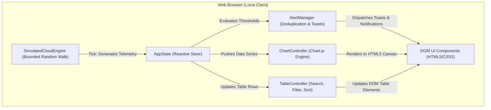

# ☁️ PulseCloud — Cloud Resource Monitoring Dashboard

[](https://github.com/)
[](https://opensource.org/licenses/MIT)
[](https://developer.mozilla.org/en-US/docs/Web/JavaScript)
[](https://www.chartjs.org/)
[](https://aws.amazon.com/cloudwatch/)
[-10B981?style=for-the-badge)](https://github.com/)

A modern, high-performance, and lightweight **Cloud Resource Monitoring Dashboard** engineered with clean semantic HTML5, modern CSS3 (with Dark Navy and Light themes), modular Vanilla JavaScript (ES2022), and Chart.js.

Designed for Cloud Engineers, DevOps specialists, and System Administrators, **PulseCloud** delivers a responsive, real-time observability console that runs completely locally without requiring paid cloud subscriptions, API keys, or backend servers. It also features a pre-architected integration bridge ready to plug into **AWS CloudWatch** and **Amazon EC2**.

---


---

## 📑 Table of Contents

- [1. Project Overview & Objectives](#1-project-overview--objectives)
- [2. Core Features & Capabilities](#2-core-features--capabilities)
- [3. Technology Stack](#3-technology-stack)
- [4. System Architecture](#4-system-architecture)
- [5. Project Directory Structure](#5-project-directory-structure)
- [6. Step-by-Step Installation & Execution](#6-step-by-step-installation--execution)
- [7. Alerting Engine & Deduplication Logic](#7-alerting-engine--deduplication-logic)
- [8. Simulated Data Engine Disclaimer](#8-simulated-data-engine-disclaimer)
- [9. Production AWS Cloud Integration Guide](#9-production-aws-cloud-integration-guide)
- [10. Security & IAM Best Practices](#10-security--iam-best-practices)
- [11. Step-by-Step GitHub Upload Guide for Beginners](#11-step-by-step-github-upload-guide-for-beginners)
- [12. Roadmap & Future Improvements](#12-roadmap--future-improvements)
- [13. License](#13-license)

---

## 1. Project Overview & Objectives

Cloud infrastructure monitoring is critical for uptime, capacity planning, and incident response. However, setting up production monitoring suites often incurs cloud infrastructure costs, complex agent configurations, and steep learning curves.

### Mission
**PulseCloud Version 1.0** was built to provide an instant, zero-friction, production-grade monitoring dashboard that:
1. **Runs anywhere instantly:** Operates in any modern web browser by simply opening `index.html` (no Node.js build pipelines or servers required).
2. **Eliminates cloud costs for learning:** Simulates realistic virtual machine workloads, diurnal variations, and network flows for hands-on operational practice.
3. **Implements real-world engineering standards:** Features stateful deduplication of alerts, multi-attribute fleet filtering, interactive sorting, time-range scaling, and accessibility.
4. **Is production-ready for AWS:** Built with a decoupled `CloudDataProvider` interface that swaps simulation out for live AWS CloudWatch APIs in minutes.

---

## 2. Core Features & Capabilities

### A. Overview Telemetry Cards
- **CPU Utilization (%):** Displays fleet-wide average compute load, live progress meter with threshold color adaptation, peak value tracking, and safe-operating-range indicators.
- **Memory Utilization (%):** Real-time allocated RAM percentage alongside total volume representation (e.g., `39.5 GB / 64 GB`).
- **Network Inbound (KB/s):** High-resolution ingress throughput with animated bandwidth activity meters.
- **Network Outbound (KB/s):** Egress throughput tracking with steady outflow monitoring.
- **Server Uptime:** Real-time incrementing cluster timer formatted into `days, hours, minutes, seconds` reflecting continuous 99.98% SLA availability.
- **Cluster Fleet Status:** Dynamic status badge (`ONLINE`, `WARNING`, `DEGRADED`) with live health breakdown (Online, Warning, Critical counters) and percentage health score.

### B. Interactive Charts (Chart.js v4.4)
- **Fleet Combined Resource Utilization:** Smooth multi-series area chart tracking CPU vs. RAM trends.
- **CPU Telemetry with Guardrails:** Historical trendline with dotted reference lines for **80% Warning** and **90% Critical** thresholds.
- **Memory Consumption Timeline:** Area chart with visual boundary line for **85% Warning**.
- **Network Bandwidth Ingress vs. Egress:** Dual-line comparison chart mapping network flow over time.
- **Hardware-Accelerated Canvas:** Smooth rendering with zero lag and theme-aware color adaptation.

### C. Server Fleet Management Table
- **Fleet Roster:** Pre-configured with realistic multi-cloud nodes (Ubuntu 22.04 LTS, Red Hat Enterprise Linux 9, Debian 12, Amazon Linux 2023, Windows Server).
- **Multi-Attribute Search:** Real-time search across instance names, instance IDs (e.g., `i-0a89f3b1e84`), or operating systems.
- **Status Filter Pills:** Instant filtering by `All`, `Online`, `Warning`, `Critical`, or `Offline`.
- **Multi-Column Sorting:** Click any column header (Server Name, Instance ID, OS, CPU, RAM, Status, Last Updated) to toggle Ascending/Descending sort orders.
- **Live Instance Inspection:** Modal drawer featuring full specifications (Private IP, Availability Zone, Instance Type, Uptime) and a micro-chart of recent telemetry.
- **Simulate Reboot:** Triggers an instance reboot cycle, setting the server to offline temporarily before recovering.
- **Launch Instance:** Dynamically spawns new simulated server nodes with randomized hardware and network footprints.

### D. Smart Alert Center & Deduplication Engine
- **Threshold Rules:**
  - `RULE-CPU-001`: CPU > 80% and ≤ 90% triggers a **WARNING** event.
  - `RULE-CPU-002`: CPU > 90% triggers a **CRITICAL** incident.
  - `RULE-MEM-001`: RAM > 85% triggers a **WARNING** event.
- **State-Transition Deduplication:** The engine checks for state transitions. If a server stays at 85% CPU over multiple intervals, it **will not** spam duplicate alerts.
- **Auto-Recovery Resolution:** When utilization drops back below thresholds, an automatic **RESOLVED** event is logged and dispatched.
- **Notification Drawer & Toasts:** Bell icon with unread badge counter, slide-out notification drawer, and floating non-intrusive toast alerts.
- **Incident Management:** Filter by severity (`Critical`, `Warning`, `Resolved`), individual acknowledgment, and "Acknowledge All".
- **Deterministic Spike Tester:** "Trigger CPU Spike" button forces a 94.6% spike on demand to test alerting and toasts.

### E. Dashboard Controls
- **Manual Refresh (Sync):** Instantly forces a telemetry cycle with rotating icon animation.
- **Pause / Resume:** Halts or resumes real-time simulation with animated status badge indicator.
- **Time-Range Selector:** Segmented window selection (`5m`, `15m`, `1h`, `24h`).
- **Dark Navy / Light Theme Toggle:** Seamless toggle between the modern Dark Navy theme and a crisp Light Slate theme. Remembers user preference in `localStorage`.
- **Mobile Responsive Drawer:** Collapsible sidebar with backdrop overlay for smartphones and tablets.

---

## 3. Technology Stack

| Layer | Technology | Description |
| :--- | :--- | :--- |
| **Structure** | HTML5 Semantic Markup | Accessible landmarks (`<nav>`, `<header>`, `<main>`, `<section>`, `<aside>`), ARIA labels |
| **Styling** | CSS3 & Custom Properties | Theme tokens, CSS Grid, Flexbox, hardware-accelerated animations, zero preprocessors |
| **Logic** | Vanilla ECMAScript (ES2022) | Object-oriented event-driven architecture, modular state management, zero frontend frameworks |
| **Visuals** | Chart.js v4.4 (CDN) | High-performance HTML5 `<canvas>` rendering, custom tooltips, dynamic theme synchronization |
| **Icons** | Pure Inline SVGs | Zero dependency on external font files; guarantees 100% offline icon rendering |

> [!NOTE]
> Strictly **zero** frontend frameworks (React, Angular, Vue, Vite, or Webpack) were used. This ensures instant load times, zero build overhead, and maximum beginner accessibility.

---

## 4. System Architecture

### Version 1: Client-Side Simulation Architecture (Current)



---

### Version 2: Production AWS CloudWatch Integration Architecture (Future)

```mermaid
flowchart LR
    subgraph Client ["Client Browser"]
        Dashboard["PulseCloud Dashboard (Vanilla JS)"]
    end

    subgraph Backend ["Secure Application Gateway (AWS / EC2)"]
        FastAPI["Python FastAPI / Flask Proxy"]
        Cache["Redis Telemetry Cache"]
    end

    subgraph AWS ["Amazon Web Services"]
        IAM["IAM Role (cloudwatch:GetMetricData)"]
        CW["Amazon CloudWatch"]
        EC2["Amazon EC2 Fleet"]
    end

    Dashboard -->|GET /api/v1/metrics (JWT Auth)| FastAPI
    FastAPI <--> Cache
    FastAPI -->|Boto3 SDK Query| IAM
    IAM -->|Fetch Telemetry| CW
    IAM -->|Describe Instances| EC2
    CW -->|Metric Data Points| FastAPI
    FastAPI -->|JSON Payload| Dashboard
```

---

## 5. Project Directory Structure

```plaintext
cloud-resource-monitor/
├── index.html                   # Master semantic HTML5 interface
├── style.css                    # Complete CSS3 design system (Dark & Light themes)
├── script.js                    # Modular Vanilla JavaScript application logic
├── README.md                    # Comprehensive professional project documentation
└── screenshots/
    └── dashboard-preview.svg    # High-resolution vector preview illustration
```

### File Breakdown
- **[`index.html`](file:///C:/Users/new/.gemini/antigravity/scratch/cloud-resource-monitor/index.html):** Contains the application layout, navigation drawer, 5 view sections (`Overview`, `Servers`, `Monitoring`, `Alerts`, `About`), modal dialogs, and SVG icons.
- **[`style.css`](file:///C:/Users/new/.gemini/antigravity/scratch/cloud-resource-monitor/style.css):** Encapsulates the complete design tokens (`--bg-app`, `--accent-cyan`, `--status-danger`), layout definitions, responsive breakpoints (<860px, <540px), and dark/light mode themes.
- **[`script.js`](file:///C:/Users/new/.gemini/antigravity/scratch/cloud-resource-monitor/script.js):** Houses the 7 core modules (`AppState`, `SimulatedCloudEngine`, `ChartController`, `AlertManager`, `TableController`, `UIController`, `CloudAdapterStub`).
- **[`README.md`](file:///C:/Users/new/.gemini/antigravity/scratch/cloud-resource-monitor/README.md):** The manual, architectural brief, AWS integration tutorial, and GitHub upload guide.

---

## 6. Step-by-Step Installation & Execution

PulseCloud requires **no compilation, no npm install, and no backend server** to run.

### Method 1: Instant Launch (Zero Installation)
1. Download or clone this repository.
2. Locate [`index.html`](file:///C:/Users/new/.gemini/antigravity/scratch/cloud-resource-monitor/index.html) in your file explorer.
3. Double-click the file to open it in Google Chrome, Mozilla Firefox, Microsoft Edge, or Safari.

---

### Method 2: Python Built-In Local Server (Recommended for Developers)
If you have Python installed on your system:
```bash
# Navigate to the project root directory
cd cloud-resource-monitor

# Start a lightweight HTTP server on port 3000
python -m http.server 3000
```
Open your browser and visit: `http://localhost:3000`

---

### Method 3: VS Code Live Server
1. Open the `cloud-resource-monitor` directory in **Visual Studio Code**.
2. Install the **Live Server** extension by Ritwick Dey.
3. Right-click on `index.html` and select **"Open with Live Server"**.

---

### Method 4: Node.js (npx serve)
```bash
# In the project directory:
npx serve .
```

---

## 7. Alerting Engine & Deduplication Logic

A major challenge in monitoring systems is **Alert Fatigue**—where operators are flooded with dozens of identical notifications when a metric oscillates around a threshold.

PulseCloud implements a **stateful transition engine** to prevent this:

```javascript
// Example deduplication transition logic (from script.js)
const cpuKey = `${server.id}_CPU`;
let currentCpuSeverity = 'NORMAL';

if (server.cpu > 90) {
  currentCpuSeverity = 'CRITICAL';
} else if (server.cpu > 80) {
  currentCpuSeverity = 'WARNING';
}

const prevCpuSeverity = AppState.activeAlertStates[cpuKey] || 'NORMAL';

// Only trigger an alert if there is a STATE CHANGE
if (currentCpuSeverity !== prevCpuSeverity) {
  if (currentCpuSeverity === 'CRITICAL' || currentCpuSeverity === 'WARNING') {
    AlertManager.triggerAlert({ ... }); // Dispatch new alert
  } else if (currentCpuSeverity === 'NORMAL' && prevCpuSeverity !== 'NORMAL') {
    AlertManager.triggerAlert({ severity: 'RESOLVED', ... }); // Auto-resolve
  }
  AppState.activeAlertStates[cpuKey] = currentCpuSeverity;
}
```

### Result:
- If a server reaches 88% CPU, an alert fires **once**.
- When it remains between 80% and 90%, **no duplicate alerts** are created.
- When it recovers to 65% CPU, a green **RESOLVED** incident is automatically posted.

---

## 8. Simulated Data Engine Disclaimer

> [!IMPORTANT]
> **Demo Data Disclosure:** All metric values, IP addresses, server IDs, and graphs displayed in **Version 1.0** are mathematically simulated client-side using bounded random-walk algorithms.
> - They do **not** represent live physical server metrics.
> - They do **not** interact with paid AWS resources.
> - They are designed to provide a completely safe, deterministic environment for development, demonstration, and learning.

---

## 9. Production AWS Cloud Integration Guide

To connect PulseCloud to live Amazon Web Services infrastructure in **Version 2.0**, follow this production blueprint.

### Step 1: Why a Backend Proxy is Mandatory
**NEVER put AWS Access Keys or Secrets directly into frontend JavaScript.**
Anyone viewing your dashboard could inspect your webpage source code and steal your AWS credentials, leading to catastrophic security breaches or massive unauthorized cloud bills.

Instead, use a secure backend proxy (Python FastAPI or Flask) hosted on an EC2 instance equipped with an **AWS IAM Role**.

---

### Step 2: Production Python FastAPI Backend Service

Create a file named `backend_service.py`:

```python
# backend_service.py
# Production AWS CloudWatch & EC2 Metric Gateway for PulseCloud Dashboard
from fastapi import FastAPI, HTTPException, status
from fastapi.middleware.cors import CORSMiddleware
import boto3
from datetime import datetime, timedelta, timezone
from typing import List, Dict

app = FastAPI(
    title="PulseCloud Telemetry Gateway",
    description="Secure proxy querying Amazon CloudWatch and EC2 APIs via Boto3",
    version="2.0.0"
)

# Configure CORS so only your dashboard domain can access this API
app.add_middleware(
    CORSMiddleware,
    allow_origins=["http://localhost:3000", "https://your-monitoring-domain.com"],
    allow_credentials=True,
    allow_methods=["GET"],
    allow_headers=["*"],
)

# Connect Boto3 using IAM Role credentials automatically assigned to EC2
# (Zero credentials hardcoded!)
cloudwatch = boto3.client('cloudwatch', region_name='us-east-1')
ec2 = boto3.client('ec2', region_name='us-east-1')

@app.get("/api/v1/fleet/status")
async def get_fleet_status() -> List[Dict]:
    """Retrieve real-time EC2 instance inventory."""
    try:
        response = ec2.describe_instances(
            Filters=[{'Name': 'instance-state-name', 'Values': ['running']}]
        )
        fleet = []
        for reservation in response['Reservations']:
            for instance in reservation['Instances']:
                name_tag = next((t['Value'] for t in instance.get('Tags', []) if t['Key'] == 'Name'), instance['InstanceId'])
                fleet.append({
                    "id": instance['InstanceId'],
                    "name": name_tag,
                    "type": instance['InstanceType'],
                    "zone": instance['Placement']['AvailabilityZone'],
                    "ip": instance.get('PrivateIpAddress', 'N/A'),
                    "state": instance['State']['Name'].upper()
                })
        return fleet
    except Exception as e:
        raise HTTPException(status_code=500, detail=str(e))

@app.get("/api/v1/metrics/cpu")
async def get_instance_cpu(instance_id: str, minutes: int = 15):
    """Query CloudWatch CPUUtilization metric for a specific instance."""
    now = datetime.now(timezone.utc)
    start = now - timedelta(minutes=minutes)

    try:
        results = cloudwatch.get_metric_data(
            MetricDataQueries=[{
                'Id': 'cpu_query',
                'MetricStat': {
                    'Metric': {
                        'Namespace': 'AWS/EC2',
                        'MetricName': 'CPUUtilization',
                        'Dimensions': [{'Name': 'InstanceId', 'Value': instance_id}]
                    },
                    'Period': 60,
                    'Stat': 'Average'
                },
                'ReturnData': True
            }],
            StartTime=start,
            EndTime=now
        )
        return results['MetricDataResults'][0]
    except Exception as e:
        raise HTTPException(status_code=500, detail=str(e))
```

---

### Step 3: Connect Frontend to Backend

In `script.js`, locate the `CloudAdapterStub` object at the bottom of the file. Update the `apiBaseUrl` and point `fetchFleetMetrics()` to your FastAPI backend:

```javascript
const CloudAdapterStub = {
  apiBaseUrl: 'http://localhost:8000/api/v1',

  async fetchFleetMetrics() {
    try {
      const response = await fetch(`${this.apiBaseUrl}/fleet/status`);
      if (!response.ok) throw new Error('API request failed');
      const data = await response.json();
      return data;
    } catch (err) {
      console.error('Failed to load AWS telemetry:', err);
      return null;
    }
  }
};
```

---

## 10. Security & IAM Best Practices

When deploying to AWS, follow the **Principle of Least Privilege**:

1. **IAM Role Policy (Read-Only):** Attach an IAM role to your backend EC2 instance with strictly read-only permissions for CloudWatch and EC2:
   ```json
   {
     "Version": "2012-10-17",
     "Statement": [
       {
         "Effect": "Allow",
         "Action": [
           "cloudwatch:GetMetricData",
           "cloudwatch:GetMetricStatistics",
           "cloudwatch:ListMetrics",
           "ec2:DescribeInstances",
           "ec2:DescribeInstanceStatus"
         ],
         "Resource": "*"
       }
     ]
   }
   ```
2. **Never commit `.env` or credential files:** Ensure your `.gitignore` contains all secret files:
   ```plaintext
   .env
   *.pem
   *.key
   credentials
   ```
3. **Control API Costs with Caching:** CloudWatch API calls (`GetMetricData`) incur small costs per query. Cache responses on the backend using Redis or in-memory dictionaries with a 60-second TTL to avoid redundant API charges.

---

## 11. Step-by-Step GitHub Upload Guide for Beginners

Follow this step-by-step walkthrough to upload your project to GitHub.

### Step 1: Open Terminal in the Project Directory
On Windows, open PowerShell and navigate to the project directory:
```powershell
cd C:\Users\new\.gemini\antigravity\scratch\cloud-resource-monitor
```

### Step 2: Initialize Git
```bash
git init
```

### Step 3: Create a `.gitignore` File
Create a `.gitignore` file to ensure unnecessary OS cache files are ignored:
```bash
echo "# OS Files" > .gitignore
echo "Thumbs.db" >> .gitignore
echo ".DS_Store" >> .gitignore
echo "# Editor Directories" >> .gitignore
echo ".vscode/" >> .gitignore
echo ".idea/" >> .gitignore
```

### Step 4: Stage and Commit All Files
```bash
# Add all files to staging
git add .

# Verify staged files
git status

# Create your first professional commit
git commit -m "feat: initial commit for PulseCloud v1.0 monitoring dashboard"
```

### Step 5: Create a New GitHub Repository
1. Log in to [GitHub](https://github.com/).
2. In the top-right corner, click **+** and select **New repository**.
3. Name your repository: `cloud-resource-monitor` (or `pulsecloud-dashboard`).
4. Set visibility to **Public**.
5. **Do NOT** check "Add a README file", ".gitignore", or license (we already created them!).
6. Click **Create repository**.

### Step 6: Link Local Repository and Push to GitHub
Copy the commands shown on your GitHub repository page and run them:
```bash
# Set default branch to main
git branch -M main

# Link your local repo to GitHub (replace YOUR-USERNAME with your actual GitHub username)
git remote add origin https://github.com/YOUR-USERNAME/cloud-resource-monitor.git

# Push your code to GitHub
git push -u origin main
```

---

### Step 7: Host for Free on GitHub Pages (Instant Live Demo!)
Turn your repository into a live website in 2 clicks:
1. In your GitHub repository, go to **Settings** > **Pages** (on the left menu).
2. Under **Build and deployment** > **Branch**, select `main` from the dropdown and leave the folder as `/ (root)`.
3. Click **Save**.
4. Within 60 seconds, GitHub will give you a live URL: `https://YOUR-USERNAME.github.io/cloud-resource-monitor/`

---

## 12. Roadmap & Future Improvements

- [x] **v1.0 (Current):** Standalone pure HTML5/CSS3/Vanilla JS dashboard with bounded random-walk telemetry, multi-series Chart.js graphics, interactive server fleet table, smart alert deduplication, and dark/light themes.
- [ ] **v1.1:** Add historical CSV export for logged incidents and telemetry data.
- [ ] **v1.2:** Sound notifications toggle for Critical alerts using Web Audio API synthesis.
- [ ] **v2.0:** Full AWS CloudWatch & EC2 live telemetry connector via Python FastAPI backend with JWT authentication.
- [ ] **v2.1:** Docker containerization (`Dockerfile` and `docker-compose.yml`) for one-command deployment.

---

## 13. License

Distributed under the **MIT License**. See `LICENSE` for more information.

```plaintext
MIT License

Copyright (c) 2026 PulseCloud Contributors

Permission is hereby granted, free of charge, to any person obtaining a copy
of this software and associated documentation files (the "Software"), to deal
in the Software without restriction, including without limitation the rights
to use, copy, modify, merge, publish, distribute, sublicense, and/or sell
copies of the Software, and to permit persons to whom the Software is
furnished to do so, subject to the following conditions:

The above copyright notice and this permission notice shall be included in all
copies or substantial portions of the Software.

THE SOFTWARE IS PROVIDED "AS IS", WITHOUT WARRANTY OF ANY KIND, EXPRESS OR
IMPLIED, INCLUDING BUT NOT LIMITED TO THE WARRANTIES OF MERCHANTABILITY,
FITNESS FOR A PARTICULAR PURPOSE AND NONINFRINGEMENT. IN NO EVENT SHALL THE
AUTHORS OR COPYRIGHT HOLDERS BE LIABLE FOR ANY CLAIM, DAMAGES OR OTHER
LIABILITY, WHETHER IN AN ACTION OF CONTRACT, TORT OR OTHERWISE, ARISING FROM,
OUT OF OR IN CONNECTION WITH THE SOFTWARE OR THE USE OR OTHER DEALINGS IN THE
SOFTWARE.
```

---

<p align="center">
  <strong>PulseCloud Monitoring Dashboard</strong> • Built with ❤️ for Cloud Enthusiasts &amp; DevOps Engineers
</p>
